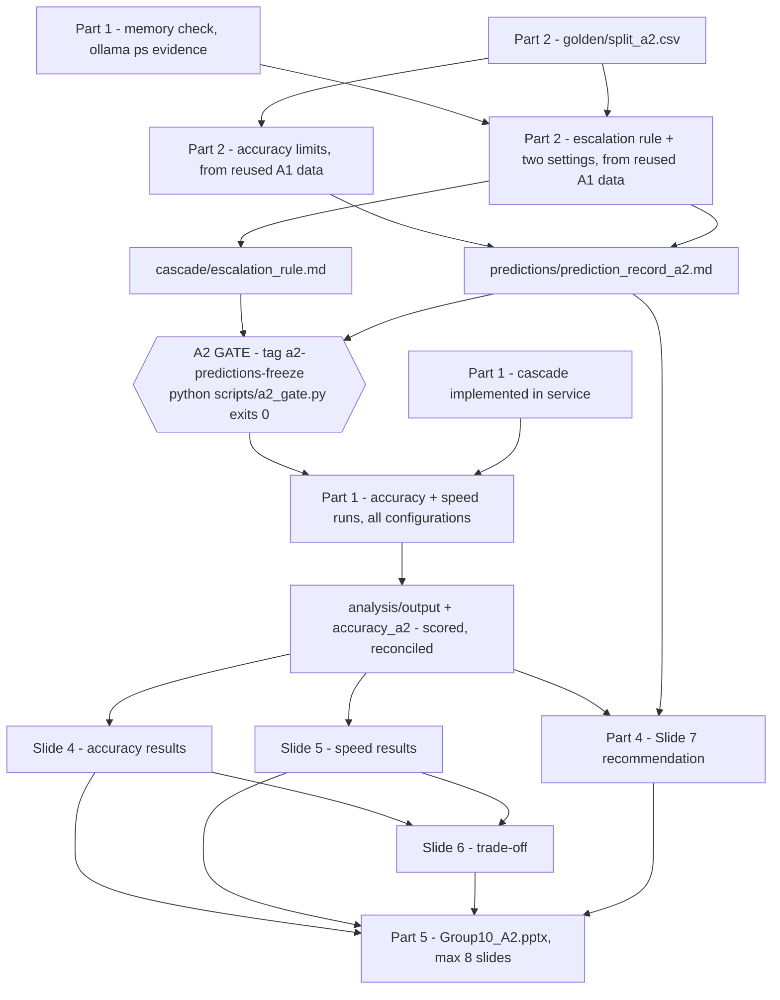

# ICT3113 Performance Optimisation and Design — Assignment 2 — Team 10

**Module:** ICT3113 Performance Optimisation and Design
**Assignment:** Assignment 2 — Performance Optimisation: Fast Triage Within an Accuracy Floor (20% of the
final mark). Brief: [`docs/assignment-2-brief.md`](docs/assignment-2-brief.md).
**Team:** Team 10, unchanged from Assignment 1. Same data slice (`data/team_rows.csv`, rows 10000–10999),
same frozen golden set (`golden/golden_set.csv`, 200 tickets, tag `golden-freeze`), same four pinned models
(`models/models.yaml`). No new rows, no new models.
**Deliverable:** one PowerPoint file named **`Group10_A2.pptx`**, **maximum 8 slides**, plus the supporting
files listed under [W.3 Submission checklist](#w3-submission-checklist). Submitted via xSiTe.
**Hard deadline:** **2359, Friday 27 November 2026.** Late submissions lose 15% per day and nothing at all is
accepted more than four days late.

This file is the team's working agreement for Assignment 2, the same way `TODO.md` was for Assignment 1: if a
task is not on this list, nobody is doing it. Tick a box only when the work is actually in the repository.

**Owner:** Part 1 — Yeo Kai Yuan maintains this file; each owner ticks their own boxes and adds any task this
list has missed. **Done looks like:** every box below ticked, and `Group10_A2.pptx` plus its supporting files
submitted on xSiTe.

---

## Carried over from Assignment 1 — read before starting anything

Assignment 2 changes none of this; it is reused, not rebuilt.

* **Golden set, frozen:** `golden/golden_set.csv`, 200 tickets, tag `golden-freeze`. Step 1 only *splits* it
  (odd/even by row number); nobody relabels anything.
* **Candidate models, pinned:** `models/models.yaml` — `llama3.2:1b-instruct-q4_K_M`, `llama3.2:3b`,
  `granite4:3b`, `qwen2.5:7b`. No new models may be introduced (brief, "Scope").
* **Top Assignment 1 model, by full-golden-set accuracy:** `qwen2.5:7b` at **74.0%** (148/200,
  `analysis/output/accuracy/model_comparison.csv`). This is the reference model for Step 1's limits. The
  other three, same source: `granite4:3b` 66.0% (132/200), `llama3.2:3b` 48.5% (97/200),
  `llama3.2:1b-instruct-q4_K_M` 26.0% (52/200).
* **Per-ticket Assignment 1 predictions already exist for all four models**, one response per golden-set
  ticket, in `results/accuracy/<model>_<timestamp>/responses.csv` (`row_number,predicted_category,...`). Step
  1's limits and Step 2's rule-tuning are computed **from these files**, not from new model calls — see
  [2.1](#21-split-the-golden-set-by-row-number) and [2.2](#22-compute-the-accuracy-limits-reuse-no-new-calls).
  This is what lets us do all of Step 1 and the tuning half of Step 2 before touching the service at all.
* **The classification prompt, `service/prompt.py`, is unchanged** and stays unchanged all through Assignment
  2 — the brief fixes it for every model in every configuration, cascade included.
* **The freeze-gate pattern** (`scripts/freeze_gate.py`) is the template for [the A2 gate](#definition-of-done--the-a2-gate)
  below: same idea (nothing may be measured before the evidence-of-prediction commit exists), new script,
  new tag.
* **Test machines, `docs/environment/`:** reused as-is unless Part 5 finds a reason to change them (see
  [5.1](#51-test-environment-write-up-reuse-assignment-1)). The client is not paying for more RAM or CPU, so
  neither are we.

---

## Already scaffolded — fill these in, do not recreate them

These exist on disk already, ahead of the gate, so nobody's AI session re-invents their shape. Fill in the
`TODO(a2)` placeholders; don't restructure the files.

| File | State | Owner to fill it in |
|---|---|---|
| [`golden/split_a2.csv`](golden/split_a2.csv) | **Done.** Generated mechanically from `golden/golden_set.csv` by row-number parity: 99 tuning rows, 101 test rows. Nothing left to do here. | — |
| [`scripts/a2_gate.py`](scripts/a2_gate.py) | **Done**, working — ported from `scripts/freeze_gate.py`, gates on `predictions/prediction_record_a2.md`, `cascade/escalation_rule.md` and `golden/split_a2.csv`, tag `a2-predictions-freeze`. Run `python scripts/a2_gate.py` any time to check status. | — |
| [`cascade/README.md`](cascade/README.md) | Done — read-first for Part 2. | — |
| [`cascade/escalation_rule.md`](cascade/escalation_rule.md) | Skeleton with `TODO(cascade)` placeholders in the fixed section order from the interface table below | Part 2 — Loh Wen Xuan, §2.5 |
| [`docs/a2/accuracy_limits.md`](docs/a2/accuracy_limits.md) | Skeleton with `TODO(a2)` placeholders; §3 gives the exact reproduction steps | Part 2 — Loh Wen Xuan, §2.2 |
| [`docs/a2/arrival-rate.md`](docs/a2/arrival-rate.md) | Skeleton with `TODO(a2)` placeholders | Part 1 — Yeo Kai Yuan, §1.3 |
| [`predictions/prediction_record_a2.md`](predictions/prediction_record_a2.md) | Skeleton with `TODO(a2)` placeholders and the sign-off table | Part 4 — Toh Si Pei, §4.2, whole team in §W.1 |
| [`slides/outline_a2.md`](slides/outline_a2.md) | Done — the Assignment 2 build plan, mirroring `slides/outline.md`'s format, one section per slide with the brief's requirements as checkboxes | Part 5 — Koh Tong Wei assembles from it, §5.5 |
| [`service/cascade.py`](service/cascade.py) | **Interface stub** — dataclasses and function signatures fixed (`should_escalate`, `classify_with_cascade`), both bodies raise `NotImplementedError`. Not wired into `service/main.py`. The leakage guardrail (never pass a label into `should_escalate`) is written into its docstring. | Part 1 — Yeo Kai Yuan, §1.2 |
| [`workload/speed_test_rows_a2.txt`](workload/speed_test_rows_a2.txt) + [`data/speed_test_tickets_a2.csv`](data/speed_test_tickets_a2.csv) | **Done.** The fixed 10-ticket speed-test workload (5 typical, 5 long by narrative length), picked deterministically from the 800 non-golden team rows. The `.txt` is a required submission supporting file; the `.csv` is the matching JMeter input. | — (review only) |
| [`docs/playbooks/cascade-test.md`](docs/playbooks/cascade-test.md) | Drafted — states what's new versus `load-test.md` only (gate, rate, ticket list, two-model warm-up); one `TODO(a2)` left for the actual run command once §1.3's script exists | Part 5 — Koh Tong Wei, §5.2 |
| [`docs/a2/run-log.md`](docs/a2/run-log.md) | Skeleton, same rules as `docs/run-log.md` (Assignment 1's) — a **separate file**, so an A1 entry is never mistaken for A2 evidence | Part 5 — Koh Tong Wei, §5.2 |
| [`tests/test_cascade.py`](tests/test_cascade.py) | **Done** — 4 structural guardrail tests: `should_escalate()`, `SmallModelAnswer` and `classify_with_cascade()` can't carry a label-shaped field, and `CascadeResult` names the final answer generically. Passing now against the stub; keep passing once implemented. | — (extend if you add more fields) |
| [`slides/team_a2.yaml`](slides/team_a2.yaml) | **Done** — Slide 1 cover data, same shape as `slides/team.yaml`, course/title/roles updated to Assignment 2. Not wired into any build script yet. | Part 5 — Koh Tong Wei, §5.5 |

`scripts/a2_gate.py` currently reports **blocked**, correctly — none of the three required files has real
content or a commit yet. Run `python scripts/a2_gate.py` yourself to see the live list of what's still
missing; it is more current than any status note in this file.

---

## Guardrails and shared interfaces — read before prompting an AI assistant

Five people will be prompting five separate AI sessions this week, each blind to what the other four are
building. Two different failure modes follow from that, and this section exists to head off both: an agent
doing something the brief forbids because it was never told, and two agents independently inventing
incompatible shapes for the same file. Paste the relevant parts of this section into your own session before
you ask it to build anything.

### A. Hard constraints — an agent will not know these unless you say so

An AI assistant optimises for "make the tests pass" and "make the number better." Several of the brief's
rules exist specifically to stop a well-meaning agent from doing exactly that in a way that invalidates the
result. Tell your agent these explicitly; do not assume general competence covers them.

1. **No new models, ever.** Only the four tags already pinned in `models/models.yaml`. An agent hunting for
   "a smaller model that might classify better" is out of scope regardless of how it reasons about it.
2. **The classification prompt is frozen.** `service/prompt.py`'s template, and therefore `PROMPT_HASH`, does
   not change for any model in any configuration — including inside the cascade. An agent "tuning the prompt
   so the small model classifies better" breaks the one fixed point every other number depends on. This does
   **not** forbid a separate, rule-only prompt if the escalation rule needs one (brief, Example method 3: a
   second call asking for HIGH/LOW confidence) — the restriction is only on the prompt actually used to
   classify the ticket, which must be the one unchanged template for every call that produces a category.
3. **No caching, anywhere, ever** — not of a final classification, not of a small-model answer reused across
   the two cascade settings to save a call. Every ticket in every reported run gets a real model call. This
   is easy for an agent to violate by accident while "optimising" the cascade driver script.
4. **Ollama's inference settings are recorded once and never touched again** — thread count, parallelism,
   context length, `OLLAMA_NUM_PARALLEL`, `OLLAMA_MAX_LOADED_MODELS`. An agent asked to "make the cascade run
   faster" by raising `OLLAMA_NUM_PARALLEL` for that configuration only silently breaks comparability with
   every other configuration's numbers.
5. **No new component.** The escalation rule may add at most one extra model call (a second prompt, a second
   small model, a confidence ask). It may never add a trained classifier, a retrieval step, or anything that
   was not part of the Assignment 1 system.
6. **The escalation rule must never see the true label at inference time.** `service/cascade.py`'s
   decision path reads only what the small model itself produced — its predicted category, its raw text, a
   confidence word, the ticket's length. It is fine, and required, to *tune* the rule's settings by checking
   against golden labels on the tuning set offline (§2.4) — but the deployed decision function in the service
   must not import or read `golden/golden_set.csv`. An agent writing the rule from "make accuracy go up" as
   the only instruction will reach for the label if it is anywhere in scope, because that is the easiest way
   to raise the number. Watch for it in review.
7. **Tune on tuning rows only, score on test rows only.** Any script that touches accuracy to choose a
   setting must filter `golden/split_a2.csv` to `set == "tuning"` first. An agent asked to "find the best
   threshold" over the whole 200 will find one — and it will mean nothing, because the brief's whole point is
   that the test-set score must come from a rule that never saw those tickets.
8. **Exactly two cascade settings, not more.** An agent iterating "just try a few more thresholds and report
   the best one" is quietly p-hacking the result and also blowing the time budget.
9. **`POST /tickets`'s response shape does not change.** The caller cannot tell which model answered from the
   HTTP response — only the service log carries that. Do not let an agent add `model_used` or `escalated` to
   the JSON response because it seems convenient for debugging.
10. **No Assignment 1 speed figures may be reused for anything**, `qwen2.5:7b` included — every speed-tested
    configuration is freshly measured under Assignment 2's conditions (new arrival rate from S, same
    workload-ticket list, same warm-up). An agent drafting Slide 5 by reading `analysis/output/load/` (the
    Assignment 1 directory) is using disallowed numbers; Assignment 2's figures belong under a separate
    output path (§1.4) so this mistake is structurally harder to make.
11. **Accuracy reuse runs one way only.** Single-model accuracy *may* reuse Assignment 1's `responses.csv`,
    filtered to test-set rows (§3.1) — that is the one sanctioned reuse. It does not extend to reusing one
    cascade setting's figures for the other, or to reusing speed numbers (rule 10).
12. **The prediction record and the final escalation-rule settings are whole-team judgements.** The same rule
    already in `README.md` for Assignment 1 applies here: no agent, and no single member, supplies them alone
    (§4.2, §W.1). An agent may draft candidate numbers from the tuning-set data; the team commits the figures
    together, in the meeting, out loud.
13. **If a proposed change's scope is genuinely unclear, ask before collecting measurements, don't guess.**
    The brief says this outright: *"Teams that are unsure whether a proposed change is within scope should
    ask before collecting measurements."* An agent will always produce *a* justification for why its chosen
    interpretation is fine — that is not the same as the interpretation being within scope. If a change to
    the escalation rule, the cascade, or the test procedure doesn't clearly fall under "may change" in the
    brief's Scope section, flag it to the module team before running anything on it, not after.

### B. Shared interfaces — pin these before anyone's agent starts writing code

Five independent sessions will each invent file shapes if not told what to produce. Where two parts' outputs
meet, a mismatch here is a merge-time bug, not a review-time one — fix it now, not after Part 3's analysis
script fails to parse Part 1's log line.

| Interface | Fixed shape | Who writes it | Who reads it |
|---|---|---|---|
| Canonical categories | The 7 names and order in `service/categories.py`'s `CATEGORIES` tuple, plus `"UNPARSEABLE"`. Never retype these by hand. | — (already fixed) | everyone |
| `golden/split_a2.csv` | Columns exactly `row_number,set`, `set ∈ {tuning,test}` | Part 2, §2.1 | Part 2 (§2.2, §2.4), Part 3 (§3.1) |
| New service-log fields | Appended at the **end** of `LOG_FIELDS` in `service/log_schema.py` (never reorder the existing 24), `LOG_SCHEMA_VERSION` bumped. Proposed names: `escalated` (bool\|null), `cascade_setting` (`"A"`\|`"B"`\|null), `small_model_tag` (str\|null), `small_model_category` (str\|null — what the small model actually said, independent of what the service returned). The existing `model_tag`/`model_digest`/`predicted_category` fields continue to describe whichever model's answer the service actually returned, which is already "which model produced the final classification" for the brief's purposes. | Part 1, §1.2 | Part 1 (§1.4), Part 3 (§3.1, §3.3) |
| `docs/a2/accuracy_limits.md` | States, in this order: overall limit (%), then a per-category table with columns `category, top_model_test_accuracy_pct, limit_pct, test_set_n`, then which categories are flagged too small | Part 2, §2.2 | Part 3 (§3.2), Part 4 (§4.2), Part 5 (Slide 1) |
| `cascade/escalation_rule.md` | States, in this fixed order: method name, the exact signal computed, the exact accept/escalate condition as a literal boolean expression (not prose), the two settings as literal parameter values, the small+large tag pair, the `ollama ps` evidence | Part 2, §2.5 (content) + Part 1, §1.1 (memory evidence) | Part 1 (§1.2, implements it verbatim), Part 5 (Slide 2) |
| Cascade setting names | **"Setting A" / "Setting B"** everywhere — logs, docs, slides, scripts. Never "loose/strict" in one place and "1/2" in another. | Part 2, §2.4 | everyone |
| New top-level files/paths already decided | `golden/split_a2.csv`, `cascade/escalation_rule.md`, `cascade/README.md`, `predictions/prediction_record_a2.md`, `docs/a2/accuracy_limits.md`, `docs/a2/arrival-rate.md`, `docs/a2/run-log.md`, `docs/playbooks/cascade-test.md`, `workload/speed_test_rows_a2.txt`, `data/speed_test_tickets_a2.csv`, `service/cascade.py`, `tests/test_cascade.py`, `scripts/a2_gate.py`, `slides/outline_a2.md`, `slides/team_a2.yaml`, output dir `analysis/output/accuracy_a2/`, git tag `a2-predictions-freeze`, deck `Group10_A2.pptx` | as named throughout this file (most already created — see "Already scaffolded" above) | everyone — don't rename these locally |

### C. A prompt preamble to paste into your own AI session

Adapt the bracketed parts and give this to your assistant before asking for anything substantive, so it has
the same constraints a teammate reading this file would have:

> This is Team 10's ICT3113 Assignment 2 repository. The brief is `docs/assignment-2-brief.md`; the team's
> task breakdown is `TODO_A2.md`. I am **[your name]**, owner of **[Part N]**. My task right now is
> **[section number and title from TODO_A2.md]**. Read `TODO_A2.md`'s "Guardrails and shared interfaces"
> section in full before writing anything — in particular: don't introduce new models, don't change
> `service/prompt.py`, don't cache classification results, don't change Ollama inference settings between
> configurations, and if this touches the escalation rule, never read the true golden label at inference
> time. Use the exact file paths, field names and setting names ("Setting A"/"Setting B") given in that
> section's interface table, because four other people's work has to match them exactly. If a task would
> require a judgement call the brief assigns to the whole team (the prediction record, the final rule
> settings), draft options but flag that it needs a team decision rather than committing it yourself.

---

## Team roster

| Part | Owner | Slides | Works mainly in |
|---|---|---|---|
| Part 1 — cascade implementation, memory check, speed tests | **Yeo Kai Yuan** | 2 (with B), 5 | `service/`, `scripts/`, `jmeter/`, `analysis/` |
| Part 2 — accuracy limits, cascade design and tuning | **Loh Wen Xuan** | 2 (with A), 4 (with C) | `golden/`, `cascade/`, `docs/a2/` |
| Part 3 — accuracy testing and interpretation | **Jolie Ngai Ning Li** | 4 (with B), 6 | `analysis/`, `analysis/output/accuracy_a2/` |
| Part 4 — predictions, recommendation, defence | **Toh Si Pei** | 7 | `predictions/` |
| Part 5 — environment, playbooks, deck, limitations | **Koh Tong Wei** | 1, 3, 8 | `docs/environment/`, `docs/playbooks/`, `slides/` |

Slide content is specified slide by slide in the brief's table ([docs/assignment-2-brief.md §Deliverables](docs/assignment-2-brief.md)).
This list only says who builds each slide and when.

---

## Part 1 — Yeo Kai Yuan (cascade implementation, memory check, speed tests; Slides 2, 5)

### 1.1 Memory check — do this before designing anything

The brief is explicit that this comes first: a cascade is only a valid result if both models stay resident
throughout. This gates which pairs Part 2 may even propose.

- [ ] For each of the three plausible pairs (small = `llama3.2:1b-instruct-q4_K_M`, `llama3.2:3b` or
      `granite4:3b`; large = `qwen2.5:7b`), load both tags on the service host, send a few tickets through
      each, and run `ollama ps` to confirm **both** are listed as resident at once.
- [ ] Record the RAM given to the Ollama container (`docker-compose.yml`) next to each pair's result, and
      keep the raw `ollama ps` output as evidence — Part 2 cites it in the escalation rule document, and the
      design criterion in the brief ("Design (Step 2), 6%") explicitly asks for this check to be reported.
- [ ] If no pair fits, stop and tell the whole team immediately — the design in §2 has to change to "cascade
      not feasible, single model recommended" before the A2 gate, not after.
- [ ] Hand the surviving pair(s) to Part 2 as soon as it's confirmed, so the escalation rule can target a real
      pair.

### 1.2 Cascade implementation in `POST /tickets`

- [ ] `service/cascade.py`: **stub already in place** (interface only, both functions raise
      `NotImplementedError`) — `SmallModelAnswer`/`CascadeResult` dataclasses, `should_escalate()` and
      `classify_with_cascade()` signatures fixed, with the leakage guardrail written into the docstring.
      Implement `should_escalate()` from Part 2's `cascade/escalation_rule.md` §2–3 once it's written, then
      `classify_with_cascade()`, then wire both into `service/main.py`. Not wired in yet on purpose.
- [ ] Extend `service/main.py` so `POST /tickets` can run in three modes selected by configuration, not by
      the caller: single-model (today's behaviour, unchanged), and cascade at setting A or setting B. The
      response shape to the caller does not change — "the caller should not be able to tell which model
      produced the answer" (brief).
- [ ] Extend `service/log_schema.py` / `service/request_log.py` with the fields the brief requires: which
      model produced the final classification, and whether escalation occurred, on every request — this is
      what makes the escalation fraction derivable from the logs rather than asserted.
- [ ] Confirm `OLLAMA_NUM_PARALLEL`, `OLLAMA_MAX_LOADED_MODELS`, thread count and context length are
      unchanged from Assignment 1 and record them once — the brief forbids changing inference settings
      between configurations.
- [ ] Tests: cascade routing logic with both model calls stubbed (no model contacted by the test suite), same
      pattern as Assignment 1's `pytest` suite.

### 1.3 Run scripts for Assignment 2

- [x] `scripts/a2_gate.py`: **already built and working** — the A2 equivalent of `scripts/freeze_gate.py`:
      checks `predictions/prediction_record_a2.md`, `cascade/escalation_rule.md` and `golden/split_a2.csv` are
      committed, tracked, unmodified, and present in the tree of a commit tagged `a2-predictions-freeze`,
      plus that neither markdown document still carries a `TODO(` placeholder. See
      [Definition of done](#definition-of-done--the-a2-gate).
- [ ] Extend `scripts/run_accuracy.py` (or add `scripts/run_accuracy_a2.py`) to accept `--config
      <model|cascade-a|cascade-b>` and `--rows test` so it sends only the even-row (test-set) tickets, calls
      `scripts/a2_gate.py` before posting anything, and records which model answered each ticket from the new
      log fields.
- [ ] Extend `scripts/run_load_test.sh` (or add an A2 variant) to: (a) derive the arrival rate from the
      **top model's** speed per the brief's S-based procedure, not from the Assignment 1 workload rate; (b)
      send **three** fixed warm-up tickets per run, not Assignment 1's one (brief, "Each run"), and for a
      cascade configuration make sure one reaches the large model, then confirm `ollama ps` lists both before
      the run starts — the warm-up tickets must not overlap the speed-test workload or the S tickets
      (`docs/playbooks/cascade-test.md` §4.2); (c) set the HTTP timeout to `10×S` (min 5 minutes) and the Open Model Thread Group's trailing
      pause to timeout + 1 minute.
- [ ] Measure S: restart Ollama, warm up, send three different typical-length tickets to `qwen2.5:7b` one at
      a time (not the same ticket three times), take the middle time. Record the three timings, the three
      row numbers, and S itself in `docs/a2/arrival-rate.md` (new) for Slide 3.
- [ ] **Before the first run**, record software versions, model digests and Ollama settings once (brief,
      Set-up) — reuse `docs/environment/` if genuinely unchanged from Assignment 1, otherwise re-capture with
      `scripts/capture_env.sh`. **Check they are unchanged before each configuration** — a quick diff against
      the recorded values, not a one-off capture, since this is a per-configuration check, not a per-campaign
      one.

### 1.4 Analysis script updates

- [ ] Extend `analysis/summarise_load.py` (or add `analysis/summarise_load_a2.py`) to report p50 per run with
      spread, p95 pooled across three runs (~90 requests, state the count), throughput and error rate — same
      shape as Assignment 1, same script where possible. **Do not add p99** — the brief is explicit the
      sample is too small for it, which is easy to get wrong if the script reuses a generic
      percentile-reporting helper that emits p50/p95/p99 by default.
- [ ] Report requests sent, completed, errored and **unfinished per run — never drop a run with unfinished
      requests from the output.** The brief: *"A run with unfinished requests is reported as such, not thrown
      away."* An agent asked to "clean up the results" or "filter bad runs" will reach for exactly this
      filter; it's wrong here.
- [ ] Add escalation-fraction reporting from the service logs (not from the accuracy-test figure) per cascade
      speed run, and flag any run where the two escalation fractions differ by a wide margin, as the brief
      asks ("explain any large gap").
- [ ] Extend `analysis/reconcile.py` to join on the new "which model answered" log field as well as
      `request_id`, so a cascade run can still be checked end to end against its `.jtl`.

### 1.5 After the A2 gate passes — run everything

Nothing in this block may start before `python scripts/a2_gate.py` exits 0.

- [ ] Confirm the gate: `python scripts/a2_gate.py --json` exits 0, keep its output.
- [ ] Accuracy test, test-set rows only, for: `qwen2.5:7b` alone (reference), each other single model alone,
      and the cascade at both settings. Single-model accuracy may reuse Assignment 1's `responses.csv` filtered
      to even rows (brief, Step 4) — **do not re-run those**; only the two cascade settings need new calls.
- [ ] Speed test, three runs each, for: `qwen2.5:7b` alone (required reference), every single model that
      passed both accuracy limits, and the cascade at both settings **regardless of whether it passed** —
      brief: *"If the cascade fails the accuracy limits, still report its speed, marked as not passing
      accuracy."* Carry the pass/fail verdict from [3.2](#32-check-against-the-limits) onto every place the
      cascade's speed is shown (Slide 5, Slide 6's chart), so a fast-but-failing number is never presented
      unlabelled next to the ones that qualify. Same fixed workload-ticket list and warm-up procedure for
      every configuration ([Part 5](#52-playbooks-update) owns that list).
- [ ] Reconcile every run: `python analysis/reconcile.py --run-dir results/runs/<dir>`.
- [ ] Hand the rebuilt `analysis/output/` to Part 3 (accuracy) and Part 4 (recommendation).

### 1.6 Slides 2 and 5

- [ ] **Slide 2 — Cascade design** (with Loh Wen Xuan). Diagram of the two-model call path, the escalation
      rule in full, the two settings tested, why this rule, and the `ollama ps` memory-check evidence from
      [1.1](#11-memory-check--do-this-before-designing-anything).
- [ ] **Slide 5 — Speed results.** p50 per run with spread, pooled p95, throughput and error rate for every
      speed-tested configuration, and the escalation fraction under load for the cascade. Every figure from
      `analysis/output/`.

---

## Part 2 — Loh Wen Xuan (accuracy limits and cascade design; Slide 2 with A, Slide 4 with C)

Part 2 sets the pace of Assignment 2 the same way it did Assignment 1: the A2 gate cannot pass until the
escalation rule is written and the predictions are ready to commit, and nothing may be benchmarked until the
gate opens. Everything below is computable from data already in the repository — no code, no model calls.

### 2.1 Split the golden set by row number

- [x] `golden/split_a2.csv` already generated: `row_number,set`, `set` = `tuning` for odd `row_number`, `test`
      for even — 99 tuning rows, 101 test rows. **Commit it today, on its own** — the brief: *"Commit this
      split before you do anything else."* Don't wait for the W.1 prediction meeting; see "Definition of
      done" for why bundling it with the final commit is wrong.
- [x] Counts sanity-checked (99/101, close to the brief's "about 90" test-set estimate) and already noted in
      `docs/a2/accuracy_limits.md`'s source-data table.

### 2.2 Compute the accuracy limits (reuse, no new calls)

- [ ] `docs/a2/accuracy_limits.md` (new): using `qwen2.5:7b`'s existing `responses.csv`
      (`results/accuracy/qwen2.5-7b_20261008T123045Z/responses.csv`) filtered to `golden/split_a2.csv`'s
      `test` rows and scored against `golden/golden_set.csv`, compute:
      - **Overall limit** = `qwen2.5:7b`'s test-set accuracy − 10 percentage points.
      - **Per-category limit**, for each of the seven categories = `qwen2.5:7b`'s test-set accuracy on that
        category − 15 percentage points.
- [ ] Show counts (right/wrong), not just percentages, for the overall figure and every category — the test
      set is ~90 tickets and some categories will have under 10, so a bare percentage is misleading without
      the count behind it (brief, "Small numbers").
- [ ] Flag any category too small (brief's own example: 8 tickets ⇒ one ticket is 12.5 points) for the
      per-category limit to be a fair test, and say so in the document and on Slide 1.
- [ ] Hand the two limit numbers (overall %, per-category table) to Part 4 for the predictions meeting and to
      Part 3 for scoring every other configuration against them.

### 2.3 Design the escalation rule

- [ ] Pick one approach from the brief's four examples (category-based, agreement, self-reported confidence,
      ticket length) or a documented alternative, using the pair(s) Part 1 confirms both fit in memory
      ([1.1](#11-memory-check--do-this-before-designing-anything)). Category-based is the natural first choice: it needs
      no extra model call beyond the two the cascade already makes, and it can be tuned entirely from
      existing A1 per-ticket predictions.
- [ ] Justify the choice against the alternatives in one paragraph — in particular, rule out or cost the
      "agreement" method's extra model call (brief: "two small calls may cost as much as one large call;
      measure it") before dropping it.

### 2.4 Tune the two settings, on the tuning set only

- [ ] Using the small model's existing `responses.csv`, **filtered to `golden/split_a2.csv`'s `tuning` rows
      only**, work out which predicted categories the small model gets right reliably (category-based rule)
      or the equivalent signal for whichever method was chosen in [2.3](#23-design-the-escalation-rule).
      **Never look at the small model's Assignment 1 results on the tuning set's labels through the test-set
      tickets** — the test set is scored blind, at the end, by Part 3.
- [ ] Choose two settings (e.g. two different "reliable category" lists, or two length cut-offs) that give
      visibly different escalation fractions on the tuning set, so the two reported settings actually show a
      trade-off rather than two near-identical points.
- [ ] For the chosen rule, estimate on the tuning set: how often a *wrong* small-model answer slips through
      because it predicted a "safe"/accepted category (brief, Example method 1) — this number belongs in the
      escalation rule document and feeds Part 4's predictions.

### 2.5 Write the escalation rule document (required supporting file)

- [ ] `cascade/escalation_rule.md` (new): the rule stated precisely enough that another team could implement
      it from the description alone — exact signal, exact accept/escalate condition, the two settings as
      concrete parameter values, and the memory-check evidence from Part 1. This is one of the three
      supporting files the brief requires at submission, and it must be committed **before** the A2 gate,
      alongside the prediction record.
- [ ] Hand the finished settings to Part 1 as soon as they're settled so [1.2](#12-cascade-implementation-in-post-tickets)
      can wire them in before the gate.

### 2.6 Slide 2 (with Yeo Kai Yuan) and Slide 4 (with Jolie Ngai Ning Li)

- [ ] **Slide 2 — Cascade design** (with Part 1): own the "escalation rule in full", "settings tested" and
      "why this rule" portions; Part 1 owns the diagram and the memory-check evidence.
- [ ] **Slide 4 — Accuracy results** (with Jolie Ngai Ning Li): own the overall/per-category limit lines drawn on
      the chart and the "which pass the limits" verdicts; Jolie Ngai Ning Li owns the measured accuracy numbers
      and the escalated/non-escalated breakdown.

---

## Part 3 — Jolie Ngai Ning Li (accuracy testing and interpretation; Slide 4 with B, Slide 6)

Blocked on the A2 gate for the cascade's test-set figures; the single-model test-set figures can be computed
the moment `golden/split_a2.csv` exists, since they are pure re-scoring of Assignment 1 data.

### 3.1 Score every configuration on the test set

- [ ] As soon as [2.1](#21-split-the-golden-set-by-row-number) lands: score all four single models' existing
      `responses.csv` files against `golden/golden_set.csv`, restricted to `golden/split_a2.csv`'s `test`
      rows — overall accuracy (count and %), per-category accuracy (count and %), confusion matrix. This does
      not need the gate; it uses only Assignment 1 evidence.
- [ ] **State on Slide 4 (not just in this repo) that single-model accuracy was reused from Assignment 1, not
      re-run** — the brief requires this said in the report, not just done quietly: *"Score only the test-set
      rows, and say in the report that you did this."* Name the four digests/prompt/Ollama version/machine as
      unchanged, which is the condition that makes the reuse valid.
- [ ] After the gate and Part 1's benchmark pass: score the cascade at both settings the same way, from the
      new `responses.csv` produced by `run_accuracy_a2.py`.
- [ ] `analysis/output/accuracy_a2/` (new output directory): one table per configuration, plus a
      `model_comparison_a2.csv` in the same shape as Assignment 1's, so every number traces to a file.

### 3.2 Check against the limits

- [ ] For every configuration, mark pass/fail against Part 2's overall limit and each per-category limit from
      `docs/a2/accuracy_limits.md`, and flag which categories are too small to be a fair per-category test.
- [ ] Hand the pass/fail table to Part 1 before the speed tests start — single models that fail accuracy do
      not get a speed test (brief).

### 3.3 Escalated vs non-escalated accuracy (cascade only)

- [ ] From the cascade's service logs, split the test-set results into "answered by the small model" and
      "escalated to the large model", and report accuracy separately for each group, at both settings. This is
      the number that shows whether the rule is actually catching the tickets the small model gets wrong
      (brief, Step 4).
- [ ] Compare the test-set escalation fraction here against the under-load escalation fraction Part 1 reports
      from the speed test ([1.4](#14-analysis-script-updates)); explain any large gap, since the ticket sets differ.

### 3.4 Confusion matrices and trade-off data

- [ ] Produce one confusion matrix per configuration (test set), and name which categories a configuration
      loses the most accuracy on when the small model's answer is accepted — the brief's prediction target
      for [Part 4's record](#part-4--toh-si-pei-predictions-recommendation-and-defence-slide-7).
- [ ] Build the (accuracy, median latency) point for every configuration and setting, once Part 1's speed
      numbers exist, for the Slide 6 chart — one point per configuration/setting, with the overall limit as a
      horizontal reference line.

### 3.5 Slides 4 and 6

- [ ] **Slide 4 — Accuracy results** (with Loh Wen Xuan): measured overall and per-category accuracy with counts
      for every configuration, escalation fraction, and escalated-vs-non-escalated accuracy.
- [ ] **Slide 6 — Trade-off.** One chart, accuracy vs. latency, one point per configuration and setting, the
      overall limit drawn as a line, with a short interpretation of where the cascade sits relative to the
      single models.

---

## Part 4 — Toh Si Pei (predictions, recommendation and defence; Slide 7)

Part 4's Assignment 1 role (workload model, requirements) has no direct Assignment 2 equivalent — the
workload model is reused, not rebuilt — so Part 4's Assignment 2 work is the prediction record and the final
recommendation, the same items Part 4 held the pen on for Slide 11 in Assignment 1.

### 4.1 Reuse the Assignment 1 workload model — one check, no rebuild

- [ ] Read `workload/workload_model.md` for the client's peak arrival rate. Once Part 1 reports S and the
      derived test rate ([1.3](#13-run-scripts-for-assignment-2)), state whether the Assignment 2 test rate is above
      or below that peak, and write the one-paragraph consequence (brief: "say which case you are in, on the
      limitations slide") — hand this paragraph to Part 5 for Slide 8.

### 4.2 Hold the pen on the prediction record

- [ ] Once Part 2's limits ([2.2](#22-compute-the-accuracy-limits-reuse-no-new-calls)) and rule settings
      ([2.4](#24-tune-the-two-settings-on-the-tuning-set-only)) exist, run the whole-team prediction meeting
      ([W.1](#w1-prediction-record-meeting--before-the-a2-gate)) and write `predictions/prediction_record_a2.md`
      from its template (to be created alongside this file), covering exactly the three things the brief asks
      for:
      - which configuration is expected to be the fastest that satisfies both accuracy limits, with reasons;
      - for the cascade, the expected escalation fraction, accuracy and median latency **at each of the two
        settings**;
      - which categories are expected to lose the most accuracy when the small model's answer is accepted.
- [ ] Re-read each prediction and ask whether a measurement could prove it wrong — a vague prediction earns
      nothing, same rule as Assignment 1.
- [ ] Commit the record as part of the A2 gate (see [Definition of done](#definition-of-done--the-a2-gate)).

### 4.3 Recommendation, after the results

- [ ] Once Part 1's speed tests and Part 3's accuracy tests are both in, identify the fastest configuration
      that satisfies both accuracy limits on the test set, from the team's own measurements, at the chosen
      arrival rate.
- [ ] State how much faster it is than `qwen2.5:7b` alone, and how much accuracy it gives up overall and by
      category.
- [ ] If the cascade is not the fastest qualifying configuration, say so and explain why, citing the measured
      escalation fraction and the two latency figures (brief, Step 5) — do not let the deck imply the cascade
      won if it did not.
- [ ] If no configuration besides `qwen2.5:7b` alone satisfies the limits, the recommendation is `qwen2.5:7b`,
      and the slide describes what was attempted and what it cost.
- [ ] Go back through `predictions/prediction_record_a2.md` and account for each prediction that was wrong and
      why — that account is marked, not the correctness of the predictions.

### 4.4 Slide 7

- [ ] **Slide 7 — Predictions, recommendation, defence.** Predictions against outcomes with reasons for the
      gap, the recommended configuration defended against both accuracy limits, the speed gain and accuracy
      cost, and a plain statement if the cascade did not help.

---

## Part 5 — Koh Tong Wei (environment, playbooks, deck, limitations; Slides 1, 3, 8)

### 5.1 Test environment write-up (reuse Assignment 1)

- [ ] Confirm the service, Ollama and load-generator machines are unchanged from Assignment 1
      (`docs/environment/`); if anything changed (OS update, different machine), re-run
      `scripts/capture_env.sh` for the affected role and say explicitly why the change was necessary — the
      brief does not forbid it but asks it to be reported.
- [ ] Confirm, and state on the slide, that the RAM given to Docker and to the Ollama container is unchanged
      from Assignment 1 — the client is not adding compute or memory, so the Assignment 1 figures are the
      ones that matter here too.

### 5.2 Playbooks update

- [x] `docs/playbooks/cascade-test.md` drafted: covers what's new versus `load-test.md` (the A2 gate, the
      derived arrival rate, the fixed ticket list, the two-model warm-up and `ollama ps` check). Review it and
      fill in the one `TODO(a2)` (the actual run command, once §1.3's script exists).
- [x] Fixed workload-ticket list **already chosen and generated**: `workload/speed_test_rows_a2.txt` (the 10
      row numbers — 5 typical near the median narrative length, 5 long near the 90th percentile, picked
      deterministically from the 800 non-golden team rows) and `data/speed_test_tickets_a2.csv` (the matching
      narratives, same columns as `data/team_rows.csv`, for the JMeter CSV Data Set Config). Review the
      selection; re-generate if a different length split is wanted. `speed_test_rows_a2.txt` is one of the
      three required submission supporting files.
- [ ] Run one complete A2 speed test yourself from the playbook, with Yeo Kai Yuan watching but not helping,
      and fix anything you had to ask about.

### 5.3 References, licences and AI declaration

- [ ] Confirm `docs/references.md` and the model-licence acknowledgements from Assignment 1 are still
      accurate (no new models, so this should be nearly unchanged) and add any Assignment 2-specific source.
- [ ] Write the AI declaration for Slide 8: what AI tools produced (cascade scaffolding code, JMeter plan
      edits) versus what the team decided (the escalation rule, which tests to run, the recommendation).

### 5.4 Limitations

- [ ] Collect onto Slide 8: sample size (~90 test-set tickets, some categories under 10), one machine, one
      arrival rate (and whether it is above or below the client's peak, from
      [4.1](#41-reuse-the-assignment-1-workload-model--one-check-no-rebuild)), and that the test-set tickets
      already appeared in Assignment 1's model runs (brief's own "honest caveat" in Step 1).

### 5.5 Deck assembly

- [x] `slides/outline_a2.md` already written: the Assignment 2 build plan, one section per slide with the
      brief's required content as checkboxes, owner and source files — same role `slides/outline.md` played
      for Assignment 1. Work every other owner's slide from that file, not from the brief directly.
- [ ] Build `slides/Group10_A2.pptx` (or an `_a2` variant of the existing `slides/` tooling) to exactly 8
      slides in the brief's order — one slide per numbered requirement, no agenda slide, no closing slide.
- [ ] Assemble from every owner's drafts once they're in, and do the final read-through: no figure on Slide
      4 to 7 that does not also appear in `analysis/output/` (brief: "Every figure on slides 4 to 7 must be
      traceable to a log or .jtl file in the repository").
- [ ] Check the file name is exactly `Group10_A2.pptx`, and that Slide 1 carries the group number, every
      name, every student ID, the repository link, the top model's Assignment 1 accuracy, and both limits
      from `docs/a2/accuracy_limits.md`.

### 5.6 Slides 1, 3 and 8

- [ ] **Slide 1 — Cover.** Group, names, IDs, repository link, top model and its Assignment 1 accuracy,
      overall and per-category limits.
- [ ] **Slide 3 — Test environment and method.** Machines (or refer to Assignment 1), arrival rate and why,
      workload tickets, warm-up and drain procedure, any change from Assignment 1.
- [ ] **Slide 8 — Limitations, references, AI declaration.**

---

## Whole team

### W.1 Prediction record meeting — before the A2 gate

Everyone attends. Last thing done before the gate; cannot be revised afterwards.

- [ ] Meet once Part 2's limits and tuned settings exist and fill in
      `predictions/prediction_record_a2.md` together. Toh Si Pei (Part 4) holds the pen; the predictions are
      the whole team's.
- [ ] Re-read each prediction and ask whether a measurement could prove it wrong.
- [ ] Commit `predictions/prediction_record_a2.md` **on its own** — `golden/split_a2.csv` and
      `cascade/escalation_rule.md` should already be committed well before this meeting, not bundled in here
      (see "Definition of done" for why) — then tag and perform the gate.

### W.2 Recommendation meeting — after the results

- [ ] Meet once `analysis/output/` and `analysis/output/accuracy_a2/` both hold the Assignment 2 figures, and
      decide the recommended configuration together (Part 4 drafts it beforehand from §4.3).
- [ ] Check the recommendation against both accuracy limits, requirement by requirement.
- [ ] Write down, plainly, if no configuration besides `qwen2.5:7b` alone qualifies.

### W.3 Submission checklist

- [ ] `Group10_A2.pptx`, maximum 8 slides, assembled and proofread.
- [ ] Supporting files in the same submission: `predictions/prediction_record_a2.md`,
      `cascade/escalation_rule.md`, `workload/speed_test_rows_a2.txt`.
- [ ] Repository pushed, with the `a2-predictions-freeze` tag and the raw `.jtl` files and service logs for
      every Assignment 2 run kept under `results/` and `logs/` — not submitted, but may be requested.
- [ ] Repository link on Slide 1 opens, and `docker compose` still rebuilds and runs the service with the
      cascade code included.
- [ ] Uploaded to xSiTe before 2359 Friday 27 November 2026.

---

## Dependencies

### What is blocked, and by what

1. **Every Assignment 2 benchmark run is blocked on the A2 gate**, the same way Assignment 1's runs were
   blocked on `golden-freeze`. `scripts/run_accuracy_a2.py` and the A2 load-test script must call
   `scripts/a2_gate.py` and refuse to proceed.
2. **The A2 gate is blocked on Part 2** (limits + tuned settings + escalation rule document) **and the whole
   team's prediction meeting** ([W.1](#w1-prediction-record-meeting--before-the-a2-gate)).
3. **Part 2's rule tuning is blocked on Part 1's memory check** ([1.1](#11-memory-check--do-this-before-designing-anything)) —
   the rule can only target a pair that actually fits in RAM together.
4. **Part 3's cascade accuracy scoring** is blocked on the gate and on Part 1's cascade accuracy runs; its
   single-model test-set scoring is **not** blocked — it needs only `golden/split_a2.csv`.
5. **Slide 6 (trade-off)** needs both Part 3's accuracy numbers and Part 1's speed numbers. **Slide 7
   (recommendation)** needs everything.
6. **Deck assembly** is blocked on every owner's slide draft.

### What is NOT blocked — nobody should be idle before the gate

- the cascade implementation in `service/cascade.py` and the `main.py` routing (Part 1) — can be built and
  unit-tested against stubbed model calls without touching the gate;
- the golden-set split and the accuracy-limit computation (Part 2, [2.1](#21-split-the-golden-set-by-row-number)–[2.2](#22-compute-the-accuracy-limits-reuse-no-new-calls)) — pure re-scoring of Assignment 1 data;
- the escalation-rule design and tuning (Part 2, [2.3](#23-design-the-escalation-rule)–[2.4](#24-tune-the-two-settings-on-the-tuning-set-only)) — also pure re-scoring, on the tuning half;
- single-model test-set accuracy scoring (Part 3, [3.1](#31-score-every-configuration-on-the-test-set)) — reuses Assignment 1 `responses.csv`;
- the memory check (Part 1, [1.1](#11-memory-check--do-this-before-designing-anything)) — needs the service host but not the gate;
- the A2 playbook, the fixed workload-ticket list and the environment confirmation (Part 5);
- measuring S and the derived arrival rate (Part 1, [1.3](#13-run-scripts-for-assignment-2)) — this is calibration, not a
  benchmark result, and does not touch team rows or the golden set.

### Dependency diagram



Read the diagram as: everything feeding the gate must be finished before the A2 gate is cut; everything below
it happens afterward.

---

## Definition of done — the A2 gate

`scripts/a2_gate.py` exists and is working (tested — currently reports blocked, correctly, since none of the
three files has real content yet):

```
python scripts/a2_gate.py            # human-readable explanation, exit 0 if gated
python scripts/a2_gate.py --json     # machine-readable, for the run scripts
```

**Exit code 0 and `{"ok": true, ...}` means gated. Exit code 3 and a list of reasons means not gated**, no
matter who believes otherwise. The script checks **three** files (not two — Assignment 2 adds the golden-set
split to the two Assignment 1 gated), across seven conditions:

1. `predictions/prediction_record_a2.md` exists, is tracked by git, and has no uncommitted modifications.
2. `cascade/escalation_rule.md` likewise.
3. `golden/split_a2.csv` likewise.
4. The git tag `a2-predictions-freeze` exists.
5. All three files are present **in the tagged commit's tree**, i.e. committed at or before the tag — not
   necessarily all in the *same* commit (see the ordering below).
6. None of the three has been revised since the tag (tagged blob == `HEAD` blob, for each).
7. **Neither** `predictions/prediction_record_a2.md` **nor** `cascade/escalation_rule.md` contains a `TODO(`
   or `<<<` placeholder, so an untouched template can't pass as either document. (`golden/split_a2.csv` is
   data, not prose, so it isn't placeholder-checked — same as Assignment 1 never checked `golden_set.csv` for
   placeholders.)

On success: `{"ok": true, "gate_commit", "gate_tag", "prediction_sha", "escalation_rule_sha", "split_sha"}`.

### Commit `golden/split_a2.csv` first, separately — not bundled with the others

The brief is explicit about this one, and it is easy to get backwards: *"Commit this split before you do
anything else"* (Step 1). That means **on its own, immediately**, before any tuning or design work reads it
— so the commit history proves the split predates every decision made from it, the same way the golden set
itself had to predate Assignment 1's measurements. It does **not** need to land in the same commit as the
prediction record: condition 5 above only requires it be present, unmodified, by the time of the tag — and a
file committed early stays present in every later commit's tree unless something deletes it. So: commit the
split today, commit the escalation rule and accuracy limits as they're finished, and only the prediction
record waits for the final W.1 meeting.

### The gate, step by step

- [ ] `golden/split_a2.csv` committed **now, on its own** — see above. Don't wait for the prediction meeting.
- [ ] `docs/a2/accuracy_limits.md` committed, with the overall limit, every per-category limit, and the
      counts behind each percentage (Part 2), as soon as it's filled in.
- [ ] `cascade/escalation_rule.md` committed: rule, signal, both settings, memory-check evidence (Part 1 +
      Part 2), as soon as it's filled in.
- [ ] `predictions/prediction_record_a2.md` written in the prediction meeting ([W.1](#w1-prediction-record-meeting--before-the-a2-gate)),
      then committed in its own final commit. Nothing else belongs in that commit — the other two files are
      already committed by this point.
- [ ] Tag that final commit:
      `git tag -a a2-predictions-freeze -m "A2 predictions and escalation rule frozen before the first A2 benchmark run"`.
- [ ] `python scripts/a2_gate.py --json` exits 0. Paste its output into the team channel.
- [ ] Push the commit **and the tag** (`git push --follow-tags`).

Every run directory created afterwards should store the same JSON verbatim as `gate.json`, the A2 analogue of
Assignment 1's `freeze.json`, so each run carries its own proof that it happened after the gate.

### Before the gate, use dev mode

The same `--dev` convention as Assignment 1 applies to any new A2 scripts: bypass the gate, read only
`data/dev/synthetic_tickets.csv`, write only under a gitignored `results/dev/`, stamp `"mode": "dev"`, and
refuse to touch `data/team_rows.csv` or `golden/`. **Dev-mode output is never evidence and must never appear
on a slide.**
